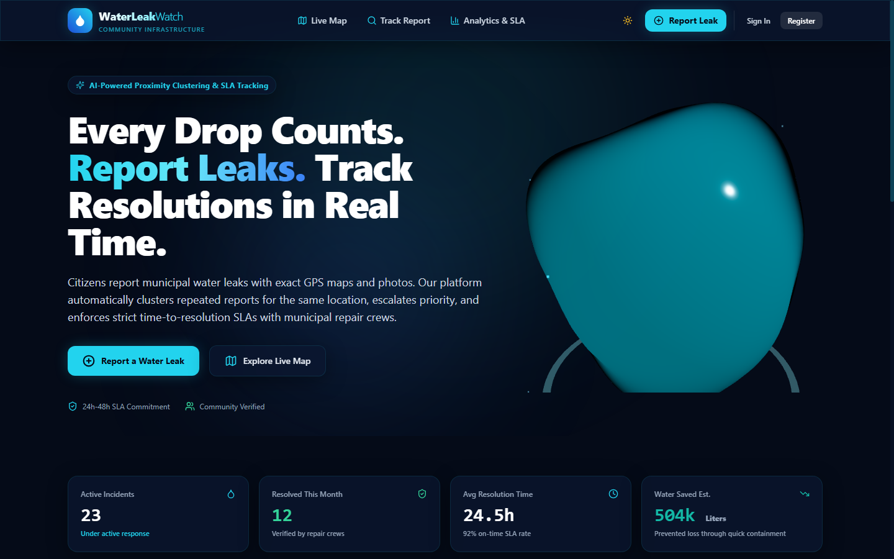
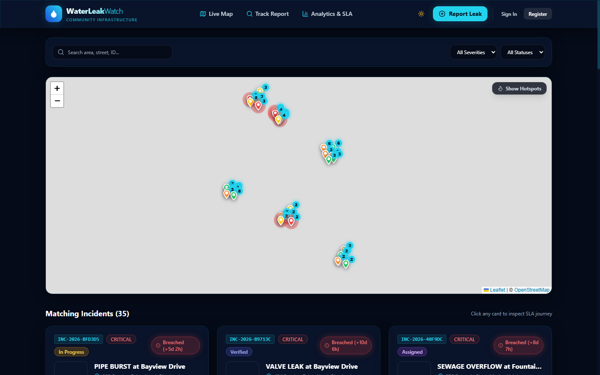
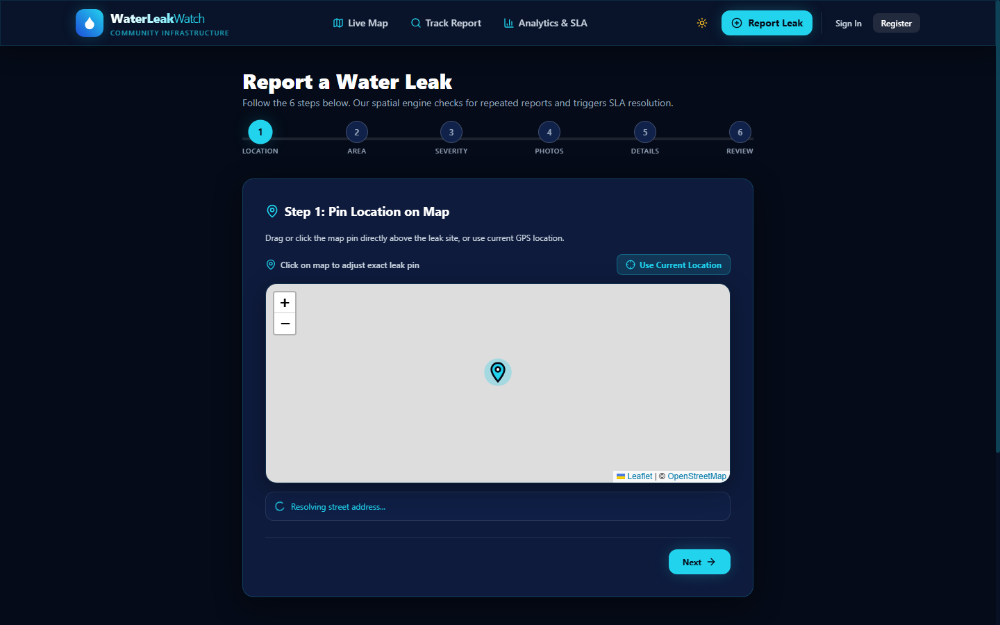
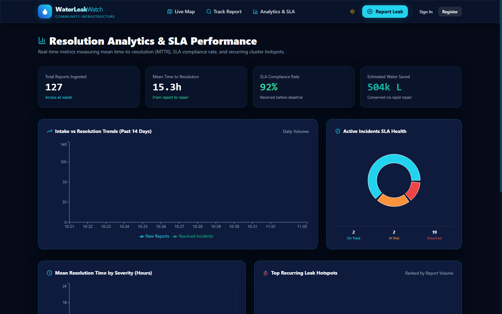
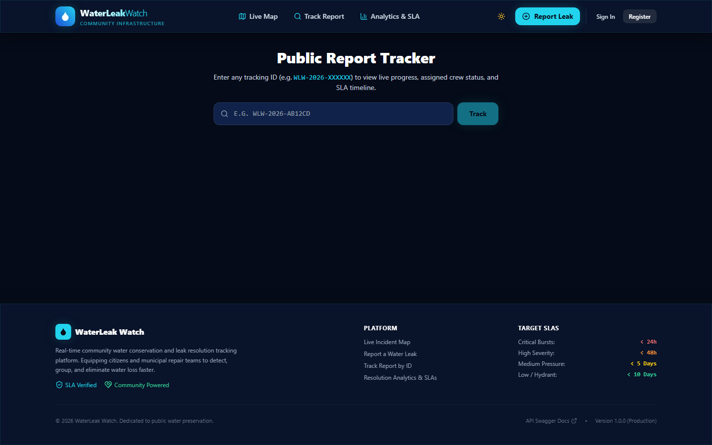
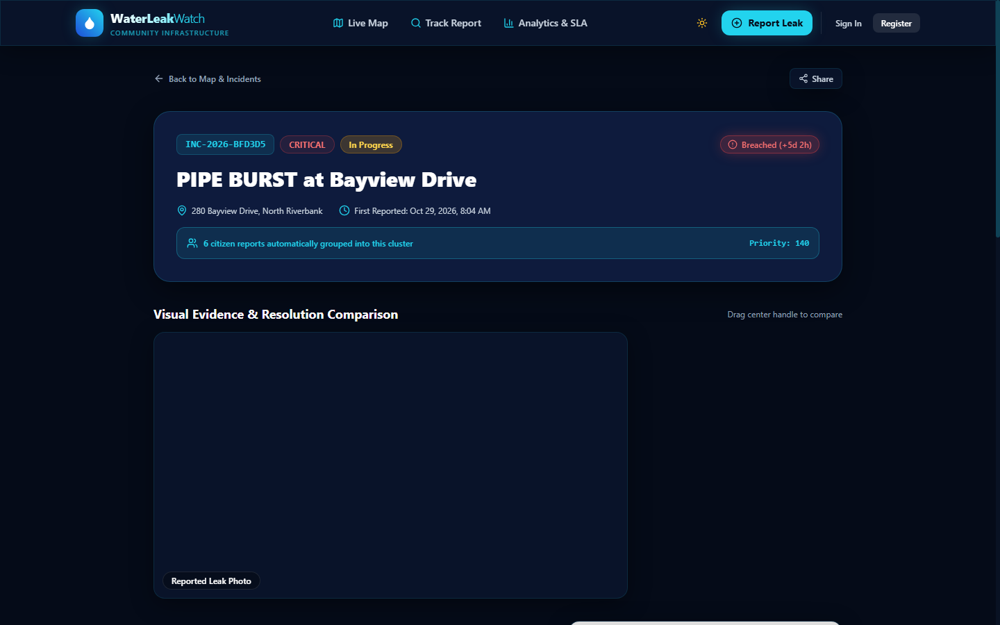
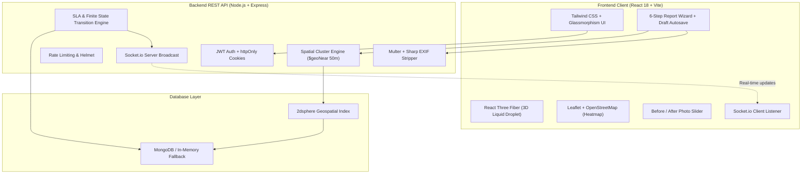
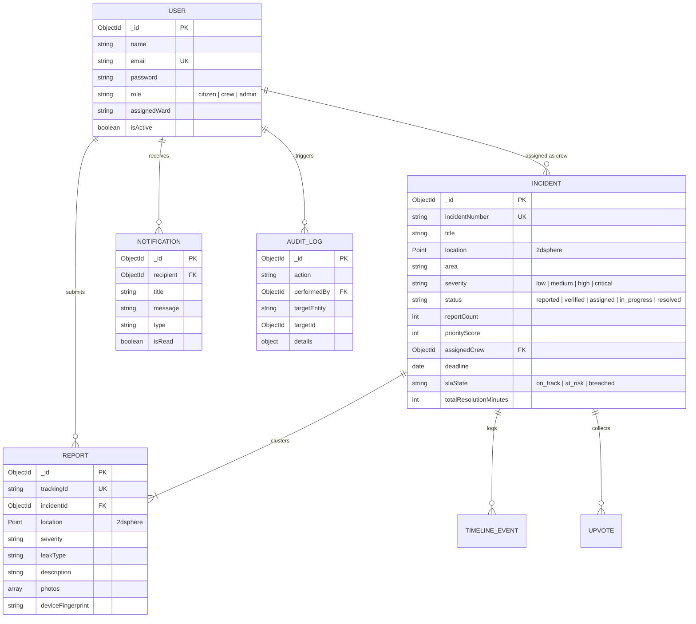

# 💧 WaterLeak Watch

> **Community Water Leak Reporting & Resolution Tracking Platform**  
> *A production-grade MERN platform featuring automated proximity incident clustering and strict time-to-resolution SLA engines.*

[](https://nodejs.org/)
[](https://react.dev/)
[](https://www.mongodb.com/)
[](https://tailwindcss.com/)
[](https://threejs.org/)
[](LICENSE)

---

## 📸 Key Application Screenshots

| 3D Hero & Live Incident Telemetry | Interactive Leak Map & Clusters |
| :---: | :---: |
|  |  |

| 6-Step Multi-Step Citizen Reporting Wizard | Resolution Analytics & SLA Trends |
| :---: | :---: |
|  |  |

| Public Tracking & Timeline Journey | Before / After Photo Inspection |
| :---: | :---: |
|  |  |

---

## 🌟 Key Algorithmic Differentiators

### 1. Repeated-Report Detection & Spatial Clustering (`$geoNear`)
* **The Problem**: When a major water pipe bursts, dozens of citizens independently file separate reports for the exact same corner, overwhelming dispatchers with duplicate jobs.
* **The Solution**: Every submission triggers an indexed MongoDB `2dsphere` query within a 50-meter radius (`$geoNear`). If an active incident is detected, citizens receive an immediate **"Similar active leak nearby"** alert and can join the cluster.
* **Dynamic Escalation**: Each additional report increments the cluster count, escalates severity to the highest observed severity, re-calculates the incident priority score (`(severity * 10) + (reports * 5) + (upvotes * 3) + age`), and notifies assigned repair teams in real-time via Socket.io.

### 2. Time-to-Resolution & Enforced SLA Engine
* **Strict Finite State Machine**: Statuses transition unidirectionally through `Reported` ➔ `Verified` ➔ `Assigned` ➔ `In Progress` ➔ `Resolved`. Invalid shortcut jumps (e.g. `reported` directly to `resolved`) are strictly blocked server-side with HTTP 400.
* **Severity-Based Deadlines**:
  * 🔴 **Critical Burst**: 24 Hours SLA
  * 🟠 **High Severity**: 48 Hours SLA
  * 🟡 **Medium Leak**: 5 Days (120 Hours) SLA
  * 🟢 **Low / Hydrant**: 10 Days (240 Hours) SLA
* **Live SLA Badges**: Dynamically flags incidents as `On Track` (Cyan), `At Risk` (Amber, within final 25% of window), or `Breached` (Red pulsating glow) with real-time countdown tickers.
* **Interactive Before/After Slider**: When repair crews complete a job, they snap and upload an "After" resolution photo, allowing citizens and admins to wipe between the original burst and the repaired pipe.

---

## 🏗️ Architecture Diagram



---

## 🗄️ Entity-Relationship (ER) Diagram



---

## 🚀 Quickstart & Setup

### Prerequisites
- Node.js v18+ (tested on Node v20 & v24)
- npm v9+

> **Zero-Config Database**: The backend includes an automatic **in-memory MongoDB fallback** (`mongodb-memory-server`). If you do not have a local MongoDB instance running, the platform seamlessly boots an in-memory database and auto-seeds it on the very first start!

### 1. Installation
Clone the repository and install dependencies:
```bash
git clone https://github.com/your-username/waterleak-watch.git
cd waterleak-watch

# Install root, server, and client dependencies
npm install
cd server && npm install
cd ../client && npm install
cd ..
```

### 2. Environment Configuration
Copy `.env.example` files:
```bash
# Server env
cp server/.env.example server/.env

# Client env
cp client/.env.example client/.env
```

### 3. Database Seeding
To populate the database with **127 realistic reports across 35 incident clusters** (with SLA timelines and sample photos):
```bash
npm run seed
```

### 4. Running the Application
Run both backend API (`:5000`) and frontend Vite client (`:5173`) concurrently:
```bash
npm run dev
```

Open your browser to:
- **Web App**: [http://localhost:5173](http://localhost:5173)
- **Interactive Swagger API Docs**: [http://localhost:5000/api/docs](http://localhost:5000/api/docs)

---

## 🔑 Demo Credentials

| Role | Email | Password | Permissions & Purpose |
| :--- | :--- | :--- | :--- |
| **Admin** | `admin@waterleakwatch.org` | `AdminPass123!` | Full control: assign jobs to crew, merge duplicate clusters, export CSV, view audit logs. |
| **Repair Crew** | `crew@waterleakwatch.org` | `CrewPass123!` | Mobile work queue: Google Maps navigation, advance status to In Progress / Resolved, upload after photos. |
| **Repair Crew 2** | `crew2@waterleakwatch.org` | `CrewPass123!` | Second field team covering Ward 2. |
| **Citizen** | `citizen@waterleakwatch.org` | `CitizenPass123!` | Submit reports, view personal activity dashboard, confirm repeat leaks. |

*(Anonymous reporting without login is also fully supported!)*

---

## 🧪 Automated Testing

### Backend Unit & Integration Tests (Jest + Supertest)
Covers authentication, report creation, `$geoNear` 50m proximity clustering, and finite state transition enforcement:
```bash
npm run test:server
```

### Frontend Component Tests (Vitest + Testing Library)
Covers SLA badge states, countdown formatting, and visual components:
```bash
npm run test:client
```

---

## 🐳 Docker Containerization

Run the entire stack (MongoDB container, Express REST API, and Nginx-powered React client) with Docker Compose:
```bash
docker-compose up --build
```
- Client: `http://localhost:5173`
- Server: `http://localhost:5000`
- MongoDB: `localhost:27017`

---

## 🔮 Future Improvements
1. **Satellite AI Verification**: Integrate Copernicus / Sentinel-2 multispectral imagery to detect standing surface water puddles automatically.
2. **Citizen SMS Alerts via Twilio**: Send automated SMS dispatch updates to citizens who filed without an email.
3. **Smart Meter (AMI) Ingestion**: Ingest telemetry from municipal smart water meters to detect nocturnal pressure drops.
4. **Offline Mobile Queue**: Background sync queue for PWA workers in underground basements with poor cellular signal.

